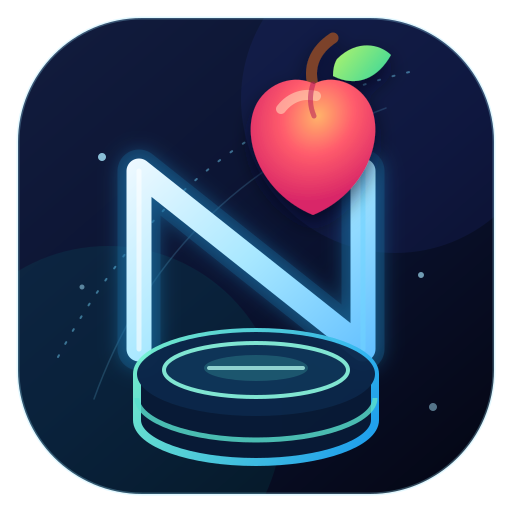

<p align="center">
  
</p>

<h1 align="center">NewtonDB</h1>

<p align="center"><strong>Una base de datos JSON diminuta con una consistencia inusualmente rigurosa.</strong></p>

<p align="center">
  Colecciones tipadas · lecturas inmutables · consultas serializables · transacciones atómicas · durabilidad honesta
</p>

<p align="center">
  <a href="https://www.npmjs.com/package/newtondb"></a>
  <a href="https://github.com/alexberriman/newtondb/actions/workflows/ci.yml"></a>
  <a href="LICENSE"></a>
</p>

NewtonDB es una base de datos de documentos incrustada y nativa de TypeScript, diseñada para aplicaciones cuyo conjunto de trabajo cabe en memoria. No tiene dependencias de tiempo de ejecución ni requiere un servidor para operar. El núcleo es neutral en cuanto a plataforma; `newtondb/node` añade un adaptador de archivos JSON con garantía ante caídas para sistemas de archivos locales de Linux.

Se trata de un rediseño mayor semántico completo. Opta por un contrato estrecho y lo valida mediante modelos basados en propiedades, historiales de transacciones, inyección de fallos nombrada, recuperación real ante muerte del proceso, instantáneas de API, pruebas de consumo del paquete, comprobaciones de mutación y benchmarks controlados.

## Instalación

```sh
npm install newtondb
```

NewtonDB es exclusivamente ESM y es compatible con Node `^22.13.0` y las versiones mantenidas de Node 24+.

## Inicio en 60 segundos

```ts
import { Database, collectionSchema, where } from "newtondb";

type Planet = {
  id: string;
  kind: "gas" | "rocky";
  moons: number;
};

const schema = {
  planets: collectionSchema<Planet>({
    primaryKey: "id",
    indexes: [{ name: "by-kind", path: ["kind"] }],
  }),
};

const db = Database.memory(
  {
    planets: [
      { id: "earth", kind: "rocky", moons: 1 },
      { id: "saturn", kind: "gas", moons: 146 },
    ],
  },
  { schema },
);

const rocky = db
  .collection("planets")
  .findMany(where<Planet>().eq("kind", "rocky"));
// readonly [{ id: "earth", kind: "rocky", moons: 1 }]

await db.collection("planets").update("earth", { moons: 2 });
```

Los documentos y matrices devueltos son instantáneas congeladas de forma recursiva. Los datos de entrada se clonan y validan, por lo que las mutaciones de la aplicación no pueden corromper silenciosamente claves o índices.

## Transacciones atómicas

```ts
const receipt = await db.transaction((tx) => {
  tx.collection("planets").update("earth", { moons: 1 });
  tx.collection("planets").insert({ id: "mars", kind: "rocky", moons: 2 });
});

console.log(receipt.revision, receipt.affected, receipt.durability);
```

Las transacciones son serializables a nivel de colección y publican una raíz inmutable. La función de devolución de llamada (callback) debe ser síncrona. Una revisión conflictiva se rechaza sin exponer registros parciales, cambios de índices, revisiones o eventos.

## Almacenamiento de archivos duradero

```ts
import { Database } from "newtondb";
import { JsonFileAdapter } from "newtondb/node";

const db = await Database.open({
  adapter: new JsonFileAdapter("./data/app.json", {
    createDirectories: true,
  }),
  initialData: { planets: [] },
  schema,
});

const receipt = await db.collection("planets").insert({
  id: "neptune",
  kind: "gas",
  moons: 16,
});

console.log(receipt.durability); // "persisted"
await db.close();
```

El adaptador de archivos bloquea antes de cargar, valida un sobre con suma de comprobaciones y versión, escribe y sincroniza un archivo temporal único en el mismo directorio, lo renombra de forma atómica y sincroniza el directorio. Un recibo persistido significa que el almacenamiento ha reconocido al menos esa revisión.

Si la persistencia falla después de la publicación, la base de datos pasa a un estado degradado y lanza un `PersistenceError` con el recibo ya comprometido. No reintentes la transacción de la aplicación; llama a `flush()` para reintentar la persistencia.

## Consultas que permanecen como datos

```ts
const condition = where<Planet>().and(
  where<Planet>().eq("kind", "gas"),
  where<Planet>().gte("moons", 10),
);

const wire = JSON.stringify(condition);
const restored = JSON.parse(wire);

const result = db
  .collection("planets")
  .query(restored)
  .orderBy("moons", "desc")
  .limit(10)
  .toArray();
```

La gramática versionada no contiene expresiones regulares ni funciones serializables arbitrarias. Los valores no se fuerzan a convertir. El analizador y el ejecutor aplican límites de profundidad, nodos, bytes, candidatos, resultados, ordenación, conjuntos y secuencias. La igualdad utiliza un índice primario o secundario declarado cuando es posible y, de lo contrario, realiza un escaneo acotado.

## Claves generadas y eventos

```ts
const generated = collectionSchema<{ id: string; text: string }>({
  primaryKey: "id",
  generatePrimaryKey: true,
});

const withEvents = Database.memory(
  { notes: [] as { id: string; text: string }[] },
  {
    schema: { notes: generated },
    eventDocuments: "include", // opt in; omitted by default
  },
);

const unsubscribe = withEvents.subscribe((batch) => {
  console.log(batch.revision, batch.changes);
});

const commit = await withEvents.collection("notes").insert({ text: "gravity" });
console.log(commit.generatedKeys[0]?.primaryKey);
unsubscribe();
```

Los eventos están ordenados por revisión y son entregados a lo sumo una vez en memoria. Los fallos de los oyentes y los diagnósticos no pueden alterar el resultado del compromiso. No son una cola duradera.

## Lo que garantiza NewtonDB

- El JSON plano y acotado entra; el JSON congelado y desacoplado sale.
- Los dominios de claves de tipo cadena y entero seguro no pueden colisionar; las claves primarias nunca mutan.
- Las restricciones de unicidad/índice declaradas y las revisiones de la colección cambian de forma atómica.
- Los planes de índice y escaneo comparten un único evaluador y un orden determinista de resultados.
- La durabilidad en memoria y persistente es explícita en cada recibo de compromiso.
- Los escritores cooperativos entran en conflicto de forma segura; se verifica la identidad/generación/revisión del almacenamiento.
- Un fallo del proceso durante cualquier límite de reemplazo mantenido recupera una instantánea antigua o nueva completa.
- El artefacto ESM empaquetado, declaraciones, exportaciones, licencias, informes de API y manifiesto de compilación se verifican en la CI.

## Límites deliberados

- La base de datos y los índices caben en memoria. El sobre de referencia medido es de 100.000 registros / 11,2 MB de JSON canónico en el perfil registrado de Node 24/Linux ARM64.
- La seguridad ante caídas de archivos está calificada únicamente para sistemas de archivos locales de Linux con renombrado atómico en el mismo directorio y sincronización funcional de archivos/directorios.
- Los bloqueos coordinan a los escritores cooperativos. Las ACLs de directorios, no el JSON de bloqueo o SHA-256, protegen contra procesos maliciosos del mismo usuario.
- Las sumas de comprobación detectan corrupción accidental; no autentican archivos ni previenen la reversión.
- No se admiten el uso en navegador, CommonJS, SQL, uniones (joins), replicación, almacenamiento en caché, consultas con expresiones regulares, índices ordenados, paginación con cursores, eventos duraderos ni importaciones profundas.
- Los validadores, predicados locales, oyentes, adaptadores personalizados y proxies de JavaScript se consideran código de aplicación de confianza.

## Documentación

| Guía                                                       | Cubre                                                      |
| ---------------------------------------------------------- | ---------------------------------------------------------- |
| [Arquitectura](docs/architecture.md)                       | raíces, superposiciones, índices, planificador, persistencia |
| [JSON y esquemas](docs/data-and-schema.md)                | valores aceptados, rutas, claves, límites máximos          |
| [Consultas](docs/queries.md)                                 | gramática, tablas de verdad, planes, complejidad, límites  |
| [Transacciones y eventos](docs/transactions-and-events.md) | aislamiento, recibos, conflictos, privacidad               |
| [Durabilidad y recuperación](docs/durability-and-recovery.md) | garantías de archivos, estado degradado, flujo de trabajo de restauración |
| [Creación de adaptadores](docs/adapters.md)                | contrato estructural y herramientas de conformidad        |
| [Errores](docs/errors.md)                                   | códigos estables y manejo seguro                           |
| [Formato de instantánea](docs/storage-format.md)            | sobre, ventana de versiones, evolución del formato         |
| [Seguridad](docs/security.md)                               | modelo de amenazas, límites de confianza, controles de denegación de servicio |
| [Soporte](docs/support.md)                                   | entornos de ejecución, plataformas, escala, superficies no admitidas |
| [Rendimiento](docs/project/performance.md)                 | metodología determinista y sobre medido                    |
| [Referencia de la API](docs/api/index.html)                | generada desde la superficie pública probada               |

Los ejemplos ejecutables cubren [memoria](examples/memory.mjs), [transacciones](examples/transactions.mjs), [serialización de consultas](examples/query-serialization.mjs), [adaptadores personalizados](examples/custom-adapter.mjs), [archivos duraderos](examples/durable-file.mjs) y [recuperación verificada](examples/recovery.mjs). La CI instala el tarball empaquetado y ejecuta cada uno.

## Proyecto

Las contribuciones son bienvenidas a través de [la guía de ingeniería](CONTRIBUTING.md). Informa las vulnerabilidades de forma privada utilizando [la política de seguridad](SECURITY.md). Las versiones siguen la [política de registro de cambios](docs/changelog-policy.md) y la [guía de operaciones del mantenedor](docs/releasing.md).

MIT © Alex Berriman
